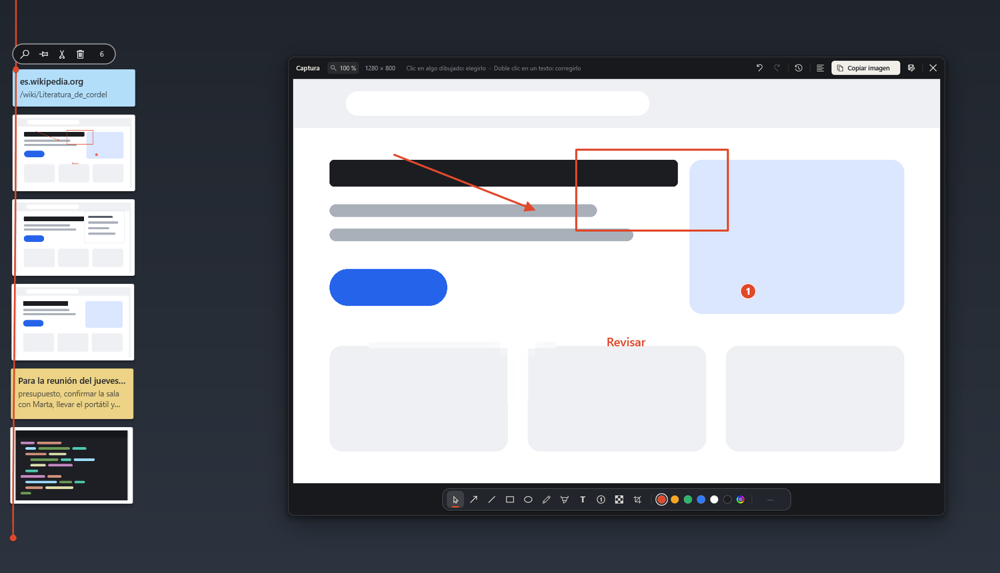
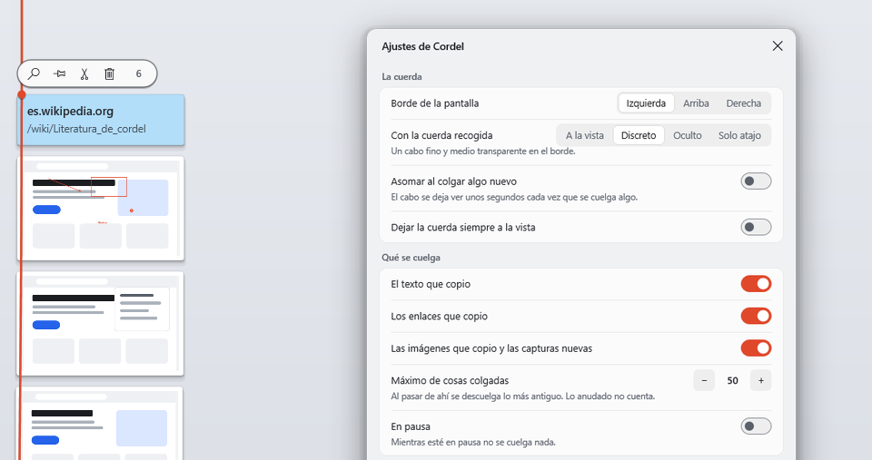

# Cordel

Una cuerda escondida en el borde de la pantalla donde se cuelgan solas las
capturas de pantalla y lo que copias. Para Windows 10 y 11 de 64 bits.

En el borde solo asoma un cabo de hilo. Al tocarlo con el ratón, el hilo cae
con todo lo colgado; al apartar el ratón, se recoge.

## Qué hace

- **Cuelga sola lo que copias** (texto, enlaces, imágenes) **y las capturas
  de pantalla nuevas.**
- **Un clic** sobre algo colgado lo vuelve a copiar; **arrastrándolo**, lo
  llevas a otro programa.
- **Busca** dentro de las notas, los enlaces y el texto que aparece en las
  capturas (lo lee el propio equipo, sin enviarlo a ningún sitio).
- **Editor de capturas**: flechas, líneas, rectángulos, texto, números de
  paso, lápiz, resaltador, pixelar para tapar algo y recortar. La captura
  original no se pierde: se puede volver a ella. (Por eso mismo, pixelar
  tapa la copia que sale de Cordel, no el archivo original de la captura.)
- **Anudar** lo que quieres conservar, **tijeras** para descolgar una parte y
  **sacudir el hilo** para descolgar todo lo que no esté anudado. Ctrl+Z lo
  devuelve.
- Cuelga del borde **izquierdo, derecho o de arriba**, en el monitor que
  quieras, y se puede dejar **siempre a la vista**.
- **Respeta lo privado**: no cuelga lo que los programas marcan como
  confidencial en el portapapeles, y puedes excluir los que quieras (por
  ejemplo, tu gestor de contraseñas).
- **Claro u oscuro**, como tengas Windows.
- **Ligera**: un único ejecutable de 2 MB, sin instalar nada aparte, y sin
  gastar procesador mientras está en reposo.
- **Sin conexión**: nada sale de tu equipo. No hay cuentas ni telemetría.

## Descargar

En la página de
[versiones](https://github.com/jguardiola-dev/Cordel/releases/latest),
descarga uno de estos dos archivos:

- **`Cordel.exe`**, para usarla sin instalar: se abre y ya está en marcha.
  No instala nada. (Lo que cuelgas se guarda en tu usuario, en la carpeta
  `%LOCALAPPDATA%\Cordel`; para abrirla, pega eso en la barra de direcciones
  del Explorador de archivos.)
- **`Cordel-instalar.exe`**, para instalarla: la deja en tu usuario (no hace
  falta ser administrador), con su entrada en el menú Inicio y su
  desinstalador.

Los demás archivos de esa página no hacen falta para usarla:
`SHA256SUMS.txt` sirve para comprobar que la descarga ha llegado entera;
`AVISOS-DE-TERCEROS.txt` y `rust-COPYRIGHT-library.html` son las licencias de
las piezas de otros autores que van dentro del programa; y los «Source code»
los añade GitHub por su cuenta (llevan los archivos de esta página, no el
programa).

Está probada en Windows 10. En Windows 11 debería funcionar igual, pero
todavía no se ha probado.

Cordel no está firmada con un certificado de pago, así que la primera vez
Windows puede avisar con «Windows protegió su PC». Si la has descargado de
esta página, pulsa «Más información» y «Ejecutar de todas formas».

Para quitarla: si la instalaste, en Configuración → Aplicaciones, busca
Cordel y pulsa Desinstalar. Si usas `Cordel.exe`: quita antes «Arrancar con
Windows» en sus
Ajustes si lo tenías puesto, ciérrala (su icono junto al reloj → «Salir») y
borra el archivo. En los dos casos lo que tenías colgado sigue en
`%LOCALAPPDATA%\Cordel` hasta que borres esa carpeta.

## Cómo se usa

- **Abrir la cuerda**: toca con el ratón el cabo que asoma en el borde, o
  pulsa el atajo de buscar (Ctrl+Alt+Espacio; si otro programa ya lo usa,
  Cordel coge otro y te dice cuál en el menú de su icono).
- **Copiar algo colgado**: un clic. **Llevarlo a otro programa**: arrástralo.
- **Verlo en grande**: doble clic. Con una captura, la tecla E abre el editor.
- **Los botones** de la cuerda: buscar, dejarla a la vista, tijeras y vaciar.
- **Ajustes**: en el icono de Cordel junto al reloj. Ahí se elige el borde,
  qué se cuelga, la carpeta de capturas, el atajo, los programas excluidos,
  arrancar con Windows y los colores.

## Cuánto gasta

Medido el 19 de noviembre de 2026 en Windows 10, con la versión 1.0.0:

- Ejecutable: 2,0 MB.
- Arranque: 0,05 segundos.
- En reposo, con la cuerda recogida: 0 % de procesador y unos 4 o 5 MB de
  memoria.
- Con la cuerda abierta y quieta: 0 % de procesador.
- Con el editor abierto sobre una captura de 1280 × 800: unos 25 MB de
  memoria; quieto, 0 % de procesador.

## Créditos

Cordel está inspirada en [Tendedero](https://tendedero.app), de Alejandro
Buján, una aplicación para macOS de código abierto (licencia MIT). Su editor
de capturas toma ideas de las funciones de
[Flameshot](https://flameshot.org) (GPL v3). El código de Cordel está escrito
desde cero y no incluye código de ninguna de las dos; su nombre, su icono y
su aspecto son propios.

Dentro del programa van además piezas de otros autores con licencias libres:
la biblioteca estándar de Rust, las de Microsoft para hablar con Windows,
SQLite y alguna más. Sus avisos están en
[AVISOS-DE-TERCEROS.txt](AVISOS-DE-TERCEROS.txt).

## Licencia

Cordel se reparte con licencia [MIT](LICENSE): se puede usar, copiar y
repartir libremente. Su código fuente no está publicado.
